  

  
  
  

### Hi, I'm Jayda 👋

I study Economics at Chulalongkorn University (GPA 3.44, graduating November 2027). I analyze data, build and evaluate models, and develop AI applications that support practical decisions. Right now I'm looking for a **Data Science internship** in forecasting, risk modeling or applied ML.

- 💼 AI/ML Engineer Intern at **KBTG**, May to July 2026, building agentic workflows on Databricks
- 🏆 First place in three team hackathons (DOH, PTT Spark Hack and CUNEX)
- 📈 Most of my projects pit a model against a simple baseline on time-ordered splits. I also write down what the numbers don't prove.

---

### 🏆 Hackathon wins

| | Project | What I worked on | Result |
|:-:|---|---|---|
| 🥇 | **CMISSION** DOH Hackathon 2026 · Jul 2026 | YOLO11n black-smoke detection for vehicle emissions | **0.763** test mAP@0.5 on 3,173 images |
| 🥇 | **CatMium** PTT Spark Hack 2025 · Jan 2026 | Engine-sound classification from spectrograms | **93.29%** accuracy, 1,500+ samples |
| 🥇 | **C-Canteen** CUNEX Hackathon (Chula × KBTG) · Apr 2025 | YOLOv8 seat-occupancy detection from canteen CCTV | 31-table pilot scope |

<b>Project notes and limits</b> (click to open)

 

- **CMISSION:** 3,173 images, 122 FPS on an NVIDIA T4 in the documented setup. The CCTV, microphone-array and edge-hardware screening system was a proposal. It was not deployed.
- **CatMium:** engine audio came from field research with Toyota K. Motors. I used peak detection, RMS windows and Librosa to cut five-second spectrogram samples. The 93.29% comes from a source-recording split in a quiet service-bay proof of concept, so it isn't a validated production diagnostic.
- **C-Canteen:** YOLOv8 instance segmentation with focus-point logic to estimate which of 31 tables were free.

---

### 🧪 Featured projects

<table>
<tr>
<td width="50%" valign="top">

#### 📉 [USD/THB Forecasting](https://github.com/chetsada-phu/usd-thb-forecasting)
I compared seven models with rolling evaluation: Random Walk, XGBoost, RNN, LSTM, Transformer, Chronos and TimesFM. The RNN won on validation, then lost to Random Walk on test (RMSE **0.1293 vs 0.1258** over 85 forecasts).

Python · PyTorch · XGBoost · Hugging Face

</td>
<td width="50%" valign="top">

#### 🛒 [Retail Sales Forecasting](https://github.com/chetsada-phu/retail-sales-forecasting)
Six approaches, eight expanding-window validation periods, 913,000 sales records. A LightGBM + seasonal blend reached **5.939** mean validation MAE: 45.6% below weekly naive and 3.46% below LightGBM alone.

Python · pandas · scikit-learn · LightGBM

</td>
</tr>
<tr>
<td width="50%" valign="top">

#### 🛡️ [Payment Fraud Risk Modeling](https://github.com/chetsada-phu/fintech-fraud-detection)
A fraud-risk pipeline on 5,948 synthetic transactions with chronological splits. XGBoost reached test AP **0.172** against **0.009** for rules, though the test set held only 10 fraud cases. Includes decision thresholds, reason codes and FastAPI scoring.

Python · scikit-learn · XGBoost · FastAPI

</td>
<td width="50%" valign="top">

#### 💬 [Text-to-SQL Data Assistant](https://github.com/chetsada-phu/text-to-sql-chatbot)
Ask questions about a CSV in plain language. It loads the file into SQLite, pulls in the relevant schema, writes the SQL and runs it read-only, with query validation and automatic repair.

Python · Streamlit · SQLite · LLMs

</td>
</tr>
</table>

---

### 🧰 Toolkit

  
  
  
  
  
  
  
  
  
  
  
  
  
  
  

---

### 🐍 Watch the snake eat my contribution graph

<picture>
  <source media="(prefers-color-scheme: dark)" srcset="https://raw.githubusercontent.com/chetsada-phu/chetsada-phu/output/snake-dark.svg">
  
</picture>

question → evidence → decision

